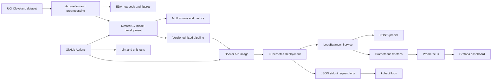

# MLOps Assignment 1: Heart Disease Classification

**Report date:** 2026-10-19
**Dataset:** UCI Heart Disease, processed Cleveland subset  
**Repository URL:** https://github.com/rimjhimdubey73/mlops_assignment
**Deployment:** Local Minikube; API available by port-forward while the VM and forward are running.

## 1. Objective and scope

This project builds a reproducible binary classifier for the presence of heart disease, tracks candidate experiments, packages the selected preprocessing/model pipeline, exposes it through a JSON API, and defines CI, container, Kubernetes, and monitoring workflows. The supplied Cleveland target is disease severity (`num` 0-4); this work maps 0 to no disease and 1-4 to disease present.

## 2. Data acquisition and EDA

The raw processed Cleveland data is downloaded from the UCI Heart Disease repository by `src.data_acquisition`. The acquisition script validates the 14-column schema and target domain before saving the source file. The 303-row source has 4 unknown `ca` values and 2 unknown `thal` values. Continuous features are median-imputed; categorical features are mode-imputed. The original severity values are retained for the initial audit, then binarized for modeling. Exact duplicates were inspected and none were found.

The EDA artifacts are `reports/figures/class_balance.png`, `reports/figures/feature_histograms.png`, and `reports/figures/correlation_heatmap.png`. The binary class counts are 164 without disease (54.13%) and 139 with disease (45.87%). The encoded EDA CSV has 28 predictors and a binary `target`. The notebook uses full-data imputations only for descriptive EDA; the modeling pipelines fit preprocessing inside each training fold.

## 3. Feature engineering and model development

Both candidates use a scikit-learn pipeline. Numeric columns receive median imputation and standard scaling; categorical columns receive most-frequent imputation and one-hot encoding. Nested stratified cross-validation uses four inner folds for ROC-AUC hyperparameter selection and five outer folds to estimate performance. The outer-fold mean and sample standard deviation are reported below.

| Model               |        Accuracy |       Precision |          Recall |         ROC-AUC |
| ------------------- | --------------: | --------------: | --------------: | --------------: |
| Logistic Regression | 0.858 +/- 0.056 | 0.864 +/- 0.060 | 0.820 +/- 0.084 | 0.920 +/- 0.024 |
| Random Forest       | 0.828 +/- 0.018 | 0.823 +/- 0.059 | 0.806 +/- 0.055 | 0.916 +/- 0.023 |

Logistic Regression was selected by mean outer-fold ROC-AUC. Its search covers `C` values 0.1, 1, and 10 and optional balanced class weights. Random Forest searches maximum depth, minimum leaf size, and optional class weights with 200 trees. These are cross-validation estimates, not independent holdout-set results. `reports/model_comparison.csv` contains the full-precision results and tuning choices.

## 4. Experiment tracking and model packaging

MLflow stores one run per candidate in the local SQLite backend (`mlflow.db`) and artifacts under `mlruns/`. Runs record the CV configuration, tuning parameters, four metric means and standard deviations, comparison data, tuning details, EDA plots, and metric plots.

The selected fitted pipeline is saved as an MLflow model and as a standalone versioned package under `models/`. The package includes the fitted imputers, scaler, encoder, classifier, input signature/example, and pinned inference requirements. `models/current_model.txt` points to the active model package. The skops serialization uses an explicit `numpy.dtype` trusted-type allowlist.

## 5. Automated testing and CI/CD

`.github/workflows/ci.yml` runs on pushes, pull requests, and manual dispatch. It installs the declared development environment, runs Ruff and pytest, acquires the dataset, trains and tracks both candidates, builds and starts the API container, smoke-tests `/health`, `/predict`, and `/metrics`, then uploads model, comparison, and MLflow artifacts. The local suite covers imputation, target binarization, one-hot encoding, both model pipelines, API response validation, metrics exposition, and request-log content. Local verification completed with Ruff clean and 7 tests passing. The uploaded GitHub Actions screenshot shows the `quality-and-training` job green, including lint, tests, training, container build, and smoke test.

## 6. API and container

`app.py` serves the packaged pipeline through FastAPI. `POST /predict` accepts all 13 original feature fields and returns the class, label, predicted-class probability as confidence, and both probabilities. `GET /health` reports model load status. `GET /metrics` exports Prometheus request and latency metrics. JSON request logs include request ID, method, path, status, and latency; request payloads are intentionally excluded.

The Dockerfile builds a Python 3.14.7 image from the versioned package requirements. The image built locally and was deployed to Minikube. The actual model loaded successfully; `/health` returned `model_loaded: true`. The documented sample prediction returned class `0`, label `no_disease`, confidence `0.5901`, and probabilities 0.5901 (no disease) / 0.4099 (disease present). Container build and live API behavior were verified locally and by the passing hosted workflow. Successful health and prediction responses are captured in `reports/screenshots/02-health-endpoint.png` and `reports/screenshots/03-predict-endpoint.png`.

## 7. Deployment and monitoring

`k8s/heart-disease-api.yaml` defines a one-replica Deployment and `LoadBalancer` Service, with startup/readiness/liveness probes, resource limits, non-root execution, and read-only root filesystem. `k8s/monitoring.yaml` deploys Prometheus and Grafana, configures API scraping, provisions a dashboard, and uses ClusterIP services for internal monitoring access. Grafana uses a Kubernetes Secret for its admin password; monitoring storage is ephemeral for this local demonstration.

**Local deployment verified:** Minikube 1.35.0 on Kubernetes 1.32.0, deployed 2026-10-19. API, Prometheus, and Grafana each rolled out with one ready replica. The API is exposed by a `LoadBalancer` Service, and a VM port-forward served successful health, prediction, and metrics requests. Prometheus reported the `heart-disease-api` target `up`; Grafana 12.1.1 returned a healthy database status and its provisioned dashboard was found. For client access, follow the README's port-forward instructions; the sample API requests returned HTTP 200 inside the VM.

## 8. Architecture

## 9. Deployment evidence and submission items

The screenshot directory includes ready Kubernetes workloads (`01-kubernetes-workloads.png`), successful health and prediction responses (`02-health-endpoint.png`, `03-predict-endpoint.png`), Grafana dashboard evidence (`Screenshot (6).png`), and successful GitHub Actions evidence (`Screenshot (9).png`, `Screenshot (15).png`). Original uploaded captures are retained as `Screenshot (16).png` and `Screenshot (17).png`. The uploaded Swagger screenshots (`Screenshot (7).png` and `Screenshot (10).png` through `Screenshot (14).png`) show endpoint documentation/examples rather than completed successful requests. The repository URL is listed above. Use the README's port-forward instructions to access the deployed API.
